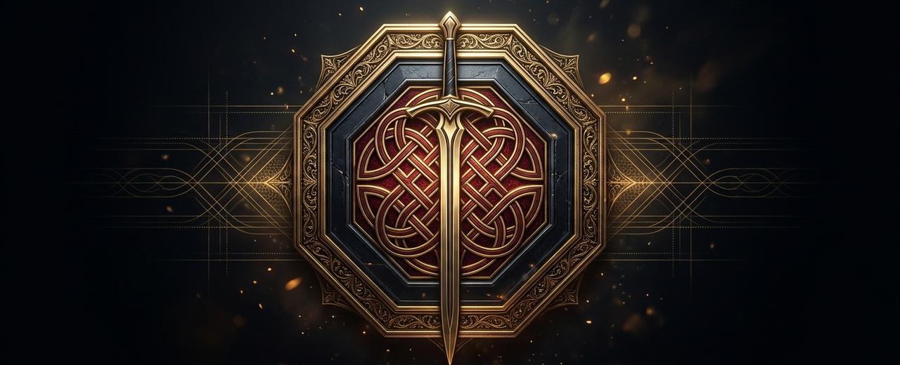
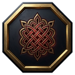
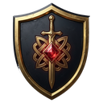
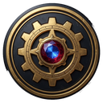

# Dark Emblem

**Native Windows x86-64 static recompilation runtime, shader compiler, and desktop launcher.**

[**Download Latest Release**](https://github.com/chivien99999/Dark-Emblem/releases/latest) · [**Quick Start**](#quick-start) · [**System Requirements**](#system-requirements) · [**Troubleshooting & Support**](#troubleshooting--support) · [**Discord**](https://discord.gg/NXnZFBS83Z) · [**Disclaimer**](#disclaimer)

---

> [!IMPORTANT]
> **Bring your own game.**
>
> Dark Emblem contains **no game data, no keys, and no precompiled game binary**, and it will not tell you where to get them. Everything is built locally on your PC from your own legally obtained Switch 2 copy, and everything it produces (the compiled binary, packed game data, shader caches, and saves) stays on your machine. **Do not share those files.**

---

## Overview

**Dark Emblem** translates your own unencrypted Switch 2 backup (`v1.2.0 / 131072`) locally into a standalone native Windows x86-64 installation — running directly on your CPU and Vulkan 1.3 GPU without runtime JIT overhead.

- **Native x86-64 Recompilation:** Translates ARM64 code directly into native AVX2/FMA x86-64 machine code (`bin/game.dll`) linked against a hardened closed-source runtime (`bin/engine.dll`).
- **Zero Developer Tools Needed:** On first setup, `Launcher.exe` automatically downloads a slim, SHA-256 verified portable LLVM archive (`toolchain-win64.zip`, ~62 MB) to compile your binary locally, then automatically removes all temporary build files. **No Visual Studio or Windows SDK required.**
- **Native Vulkan 1.3 Renderer:** Built on `VK_EXT_shader_object` with offline SPIR-V translation and driver-specific GPU binary packs (`shobjpack`), uncapped framerate with consistent 30-FPS game-logic timing, and adaptive RAM/VRAM scaling for 8 GB–24 GB systems.
- **Modern Upscaling & Frame Generation:**
  - **NVIDIA DLSS Super Resolution**, **DLSS Frame Generation**, and **NVIDIA Reflex**
  - **AMD FidelityFX Super Resolution (FSR 3.1 / FSR 4)** and **FSR Frame Generation** (including decoupled DLSS SR + FSR FG)
  - **Optional GPU BC7 Texture Cache** (cuts VRAM footprint by 2–4 GB on 8–12 GB GPUs)
- **Full Audio & Video:** Native WASAPI audio mixer and AV1/Opus cutscene playback.
- **Single-Title Scope:** Dark Emblem is locked strictly to its single target revision (`v1.2.0 / 131072`) and will not recompile or boot other titles.

---

## Included Applications

| | Application | Purpose |
| :---: | :--- | :--- |
|  | **`Launcher.exe`** | Dark-mode native setup wizard & hub — drag-and-drop backup setup, portable LLVM downloader, Play, Settings, GPU Shader rebuild, and optional BC7 Texture Cache manager. |
|  | **`Play.exe`** | Direct launch executable once setup is complete. |
|  | **`Settings.exe`** | Standalone graphics & upscaler configurator (Display mode, Output resolution, DLSS / FSR 3.1 / FSR 4, Frame Generation, Reflex, Texture Quality). |

---

## Quick Start

1. Download **`DarkEmblem-Setup-v1.0.zip`** from the [**Releases**](https://github.com/chivien99999/Dark-Emblem/releases/latest) page and extract it to a folder with at least **40 GB** of free disk space (for example `C:\Games\DarkEmblem`).
2. Double-click **`Launcher.exe`**.
3. Drag and drop your own Switch 2 backup onto the launcher window (or click **Select .nup File...** / **Select exefs+romfs Folder...**).
4. *(Optional)* Check **Build BC7 Texture Cache** if your GPU has 8–12 GB VRAM.
5. Click **INSTALL & RECOMPILE**. The launcher will:
   - Verify your backup matches the supported `v1.2.0 (131072)` revision
   - Fetch the slim portable LLVM toolchain (cached automatically)
   - Compile your native `bin/game.dll` and delete all temporary build files
   - Pack game data into `data/game.romfs` and precompile Vulkan shaders for your exact GPU
6. Click **PLAY** (or launch **`Play.exe`** directly anytime afterward).

---

## Supported Backup Formats

Dark Emblem supports **unencrypted Switch 2 backups only** (no decryption keys / `prod.keys` and no Switch 1 `.nsp`/`.xci` formats apply):

- **`.nup` Container** (`NUP\x01` v1 — raw or Zstandard-compressed, base or base+update packages)
- **Decrypted Folder** containing `exefs/` and `romfs/` (selecting the parent folder containing `131072/exefs` + `131072/romfs` is also auto-detected)

---

## System Requirements

| Component | Minimum | Recommended |
| :--- | :--- | :--- |
| **OS** | Windows 10 64-bit (1903+) | Windows 11 64-bit |
| **CPU** | x86-64-v3 (AVX2, FMA, F16C — Intel Haswell / AMD Zen 2+) | 8+ core modern desktop CPU |
| **GPU** | Vulkan 1.3 GPU with `VK_EXT_shader_object` & 8 GB VRAM | RTX 30/40/50 or RX 6000/7000/9000 (12+ GB VRAM) |
| **Memory** | 8 GB RAM *(16 GB recommended during first-time setup)* | 16–32 GB RAM |
| **Storage** | ~40 GB free space | NVMe SSD |

---

## Troubleshooting & Support

- **Updated your GPU driver?** Open `Launcher.exe` and click **Rebuild GPU Shader Cache** to refresh `shaders/shaders.devftz.lnsb` for the new driver.
- **Offline setup:** Download `toolchain-win64.zip` from the Releases page and extract it into `<InstallDir>\toolchain\` before launching `Launcher.exe` — setup will use it offline without downloading anything.
- **Save files & controls:** Stored locally under `<InstallDir>\save\` (`hzinput.ini` for keyboard/mouse/gamepad bindings, `lantern-settings.ini` for graphics settings).
- **Need support or running into issues?** Join the Discord server: https://discord.gg/NXnZFBS83Z

---

## License & Third-Party Software

Dark Emblem's runtime, recompiler, and launcher are **closed-source proprietary software** written from scratch (`All Rights Reserved` — see [LICENSE](LICENSE)).

Third-party permissively licensed open-source libraries (SDL3, dav1d, Opus, Zstandard, astcenc, bc7enc, xxHash, Vulkan-Headers, AMD FidelityFX SDK, Capstone, LZ4, LLVM) and vendor-redistributable SDK components (NVIDIA DLSS / Streamline) are credited in [THIRD_PARTY_NOTICES.txt](THIRD_PARTY_NOTICES.txt). Zero GPL or LGPL components are included.

---

## Disclaimer

Dark Emblem is a fan-made project with no connection to Nintendo, and Nintendo has not endorsed it. **Fire Emblem** and **Fortune's Weave** are trademarks of Nintendo.
